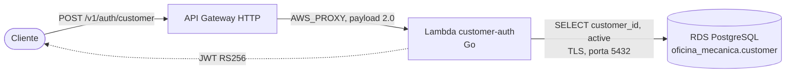

# oficina-lambda-auth

Função serverless de autenticação por CPF da **Oficina Mecânica** (FIAP 16SOAT — Tech Challenge Fase 3).
O cliente informa o CPF e recebe o JWT com que consome as rotas protegidas da API (`/v1/me/...`).

A função:

1. valida o CPF (tamanho, dígitos repetidos e dígitos verificadores);
2. consulta no PostgreSQL (RDS) se existe cliente com aquele CPF e se ele está ativo;
3. emite um JWT RS256 assinado com a mesma chave da API, com o id do cliente em `sub` e o papel
   `CUSTOMER` em `groups`. Para a API o token é indistinguível de um que ela mesma emitiu.

## Branches e ambientes

| Branch | Função |
|---|---|
| `main` | Integração. Protegida: merge somente via Pull Request. |
| `homolog` | Deploy automático em homologação. |
| `production` | Deploy automático em produção. |

## Tecnologias

- Go (runtime customizado `provided.al2023`, binário estático `bootstrap`)
- `aws-lambda-go`, `pgx` (PostgreSQL), `golang-jwt` (RS256)
- `log/slog` com saída JSON
- Testes: `go test` e Testcontainers (Postgres real)

## Arquitetura



A função roda dentro da VPC, nas mesmas subnets do cluster, e só precisa alcançar o Postgres.

Estrutura do código:

| Pacote | Papel |
|---|---|
| `cmd/auth` | ponto de entrada: lê a configuração, monta as peças e inicia a Lambda |
| `internal/cpf` | validação e normalização do CPF; o `String()` mascara o número para log |
| `internal/auth` | caso de uso `Authenticate` e as portas `CustomerLookup` e `TokenIssuer` |
| `internal/postgres` | adaptador de consulta do cliente, com conexão reaproveitada entre invocações |
| `internal/token` | emissão do JWT RS256 e leitura da chave PKCS#8 |
| `internal/handler` | evento do API Gateway, respostas no formato `ApiErrorResponseDto` e log JSON |
| `internal/config` | variáveis de ambiente |

## Contrato

```http
POST /v1/auth/customer
Content-Type: application/json

{"cpf": "529.982.247-25"}
```

| Status | `code` | Quando |
|---|---|---|
| 200 | — | `{"token", "customerId", "role": "CUSTOMER", "expiresIn": 3600}` |
| 400 | `INVALID_REQUEST` | corpo ausente, JSON inválido ou sem `cpf` |
| 400 | `INVALID_CPF` | CPF com tamanho ou dígito verificador inválido |
| 401 | `CUSTOMER_NOT_AUTHORIZED` | CPF sem cadastro **ou** cliente inativo (mesma resposta, de propósito) |
| 500 | `INTERNAL_ERROR` | banco inalcançável ou falha inesperada; a causa fica só no log |

Cliente inexistente e cliente inativo recebem a mesma resposta: dizer qual dos dois ocorreu permitiria
descobrir, testando CPFs, quem é cliente da oficina. O motivo real fica só no log.

Com o token:

```shell
curl -H "Authorization: Bearer $TOKEN" "$API_URL/v1/me/work-orders"
```

O Swagger da API documenta as rotas `/v1/me/work-orders`.

## Configuração

Tudo chega por variável de ambiente, preenchida pelo Terraform:

| Variável | Obrigatória | Default | Descrição |
|---|---|---|---|
| `DB_HOST` | sim | — | endereço do RDS |
| `DB_PORT` | não | `5432` | |
| `DB_NAME` | sim | — | |
| `DB_USERNAME` / `DB_PASSWORD` | sim | — | |
| `DB_SSLMODE` | não | `require` | o RDS recusa conexão em claro |
| `JWT_PRIVATE_KEY_B64` | sim | — | PEM PKCS#8 em base64; o mesmo par de chaves da API |
| `JWT_ISSUER` | não | `oficina-api` | precisa ser igual ao `JWT_ISSUER` da API |
| `JWT_EXPIRATION_MINUTES` | não | `60` | validade do token do cliente |

Com outra chave ou outro issuer, a função emite tokens que a API recusa com `401`.

## Executando

```shell
go test ./...                              # testes unitários
go test -tags integration ./...            # inclui o teste contra Postgres real (requer Docker)

CGO_ENABLED=0 GOOS=linux GOARCH=amd64 go build -trimpath -ldflags="-s -w" -o build/bootstrap ./cmd/auth
(cd build && zip function.zip bootstrap)   # pacote que a Lambda recebe
```

> Em macOS, se a linkagem com cgo falhar por causa do SDK, rode os testes com `CGO_ENABLED=0`, que é
> também como a função é compilada.

## Logs

Uma linha JSON por evento, com `timestamp`, `level`, `service`, `event` e `requestId` (o id da requisição
do API Gateway, para correlacionar com o access log). O CPF nunca aparece no log; o motivo de uma recusa,
sim (`reason`: `invalid-cpf`, `not-found`, `inactive`, `malformed-request`).

## Pendências

- Terraform da função e da rota no API Gateway.
- Pipeline de CI/CD por branch (`main`, `homolog`, `production`).
- Link do Swagger/Postman da API e do deploy ativo.
